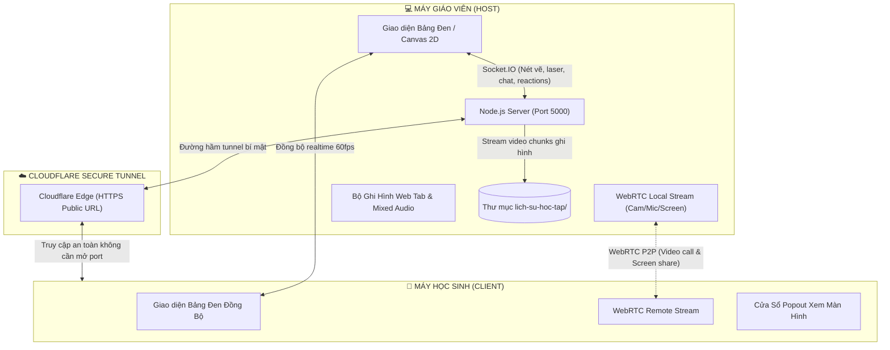

# 📚 LearnBoard - Bảng Đen Tương Tác & Video Call Dạy Học 1-1 Trực Tuyến

<div align="center">


[](https://react.dev/)
[](https://nodejs.org/)
[](https://webrtc.org/)
[](https://socket.io/)
[](https://www.cloudflare.com/)
[](https://opensource.org/licenses/ISC)

**Giải pháp dạy học trực tuyến 1-1 chuyên sâu: Bảng phấn tương tác thời gian thực, dán ảnh chữa bài tập, đàm thoại video WebRTC P2P và ghi hình toàn diện buổi học.**

*Hoàn toàn miễn phí • Không cần mua tên miền • Không cần thuê máy chủ • Khởi động bằng 1 cú nhấp chuột.*

---

</div>

## 📖 Mục Lục

- [✨ Tính Năng Nổi Bật](#-tính-năng-nổi-bật)
- [🚀 Khởi Động Nhanh (1 Click)](#-khởi-động-nhanh-1-click)
- [🔗 Hướng Dẫn Kết Nối 2 Bên](#-hướng-dẫn-kết-nối-2-bên)
- [🏗️ Sơ Đồ Kiến Trúc Hệ Thống](#️-sơ-đồ-kiến-trúc-hệ-thống)
- [🗂️ Cấu Trúc Thư Mục Dự Án](#️-cấu-trúc-thư-mục-dự-án)
- [🛠️ Công Nghệ Sử Dụng (Tech Stack)](#️-công-nghệ-sử-dụng-tech-stack)
- [⚙️ Lệnh Dành Cho Nhà Phát Triển](#️-lệnh-dành-cho-nhà-phát-triển)
- [❓ Câu Hỏi Thường Gặp & Xử Lý Sự Cố](#-câu-hỏi-thường-gặp--xử-lý-sự-cố)

---

## ✨ Tính Năng Nổi Bật

### 1. 🎨 Bảng Đen Phấn Trắng Thời Gian Thực (Real-time Canvas)
- **Nét phấn mô phỏng chân thực**: Hỗ trợ nhiều màu phấn (Trắng, Vàng chanh, Xanh ngọc, Hồng phấn, Cam...) cùng nhiều kích thước nét viết từ mảnh (2px) đến rất lớn (16px).
- **Bộ công cụ đa dạng**:
  - ✏️ **Bút phấn**: Viết chữ, công thức toán học, vẽ đồ thị.
  - 🧹 **Tẩy phấn**: Xóa vùng chọn hoặc làm sạch bảng.
  - 🖍️ **Bút dạ quang (Highlighter)**: Làm nổi bật công thức, từ khóa quan trọng.
  - 🔥 **Bút Laser giảng bài**: Tạo vệt sáng neon đỏ tan dần sau 1.5 giây, giúp học sinh tập trung vào vị trí thầy cô đang giảng giải.
  - 📐 **Công cụ hình học**: Thước kẻ đường thẳng, mũi tên chỉ dẫn, hình hộp chữ nhật, hình tròn / elip.
- **Tùy biến nền bảng**: Chuyển đổi linh hoạt giữa Bảng xanh học đường kinh điển, Bảng đen mờ chống lóa, Bảng xanh đậm và Nền kẻ ô vuông tập viết.
- **Phóng to & Di chuyển độc lập (Independent Pan & Zoom)**: Giáo viên và học sinh có thể tự do phóng to, thu nhỏ và di chuyển góc nhìn trên bảng mà không làm ảnh hưởng đến màn hình của người kia.

### 2. 🖼️ Dán Ảnh Đề Bài Trực Tiếp (`Ctrl + V`)
- Chụp ảnh màn hình đề thi/bài tập rồi bấm **`Ctrl + V`** (hoặc nút tải ảnh lên) để dán ngay tức thì lên bảng.
- Hỗ trợ kéo thả di chuyển vị trí, thu phóng kích thước, xoay và **Ghim cố định (Pin)** xuống nền bảng để cả hai bên viết lời giải đè lên ảnh.

### 3. 📹 Video Call 1-1 & Chia Sẻ Màn Hình Hai Chiều (WebRTC P2P)
- Đàm thoại Video và Âm thanh trực tiếp P2P (Peer-to-Peer) với độ trễ gần như bằng 0.
- **Chia sẻ màn hình 2 chiều (Giáo viên $\leftrightarrow$ Học sinh)**: Cả cô giáo lẫn học sinh đều có thể share màn hình bài tập.
- **Cửa sổ nổi độc lập (`screen-viewer.html`)**: Mở màn hình chia sẻ sang một cửa sổ trình duyệt riêng biệt nổi lên trên, vừa xem bài giảng vừa thao tác trên bảng.
- **Tự động thích ứng**: Tích hợp luồng Video Canvas dự phòng khi test 2 tab trên cùng 1 máy tính và tối ưu hóa `contentHint = 'detail'` chống mờ chữ.

### 4. 🎙️ Ghi Hình Buổi Học Toàn Diện (Full Web Tab & Mixed Audio)
- Nút **"Ghi hình Tab Web"** chuyên dụng: Quay lại chính xác toàn bộ giao diện bảng đen, thao tác viết vẽ, hình ảnh bài tập và video call.
- **Trộn âm thanh đa kênh (Web Audio API)**: Kết hợp đồng thời tiếng micro của giáo viên và tiếng của học sinh vào video.
- **Tự động lưu an toàn về máy**: Video được truyền từng phần (chunk) theo thời gian thực về thư mục `lich-su-hoc-tap/*.webm` trên máy tính giáo viên, không lo mất file khi đột ngột tắt trình duyệt.

### 5. ⭐ Hệ Thống Khen Thưởng Động Viên Đa Giác Quan
- 3 cấp độ khen thưởng: 👏 **Giỏi lắm**, ⭐ **10 Điểm**, ❤️ **Cố lên**.
- **Pháo hoa đặc trưng theo Emoji**: Bắn pháo hoa hình ngôi sao, điểm 100, cúp vô địch hoặc trái tim rực rỡ.
- **Bảng Vinh Danh Nổi Động**: Xuất hiện chính giữa màn hình với hiệu ứng nảy (`bounce-in`) trong 3.5 giây.
- **Âm thanh tổng hợp (Web Audio API Synth)**: Chuông chiến thắng kiểu Mario Star Power-Up và âm vang chúc mừng với độ trễ 0ms, không phụ thuộc file mp3 ngoài.

### 6. 💬 Chat & Ghi Chú Tức Thì
- Hộp thoại tin nhắn bên góc phải hỗ trợ trao đổi công thức, đường dẫn và lời nhắn nhanh.
- Hiển thị thông báo Toast nổi và biểu tượng số tin nhắn chưa đọc.

---

## 🚀 Khởi Động Nhanh (1 Click)

### Dành Cho Người Dùng Windows:
Chỉ cần nhấp đúp chuột vào file:
👉 **`CHAY_LOP_HOC.bat`**

Hệ thống sẽ tự động:
1. Giải phóng cổng 5000 (nếu có tiến trình cũ chiếm dụng).
2. Kích hoạt máy chủ Node.js cục bộ.
3. Tạo đường hầm bảo mật HTTPS miễn phí qua Cloudflare Tunnel.
4. Tự động mở trình duyệt trang Giáo viên tại `http://localhost:5000`.

---

## 🔗 Hướng Dẫn Kết Nối 2 Bên

1. **Khởi động ứng dụng**: Chạy file `CHAY_LOP_HOC.bat` (hoặc lệnh `npm run app`).
2. **Lấy link gửi học sinh**:
   - Nhìn vào cửa sổ Terminal hoặc bấm nút **"Gửi link"** ở thanh Camera góc trên bên phải.
   - Đường link có dạng:
     ```text
     https://random-subdomain.trycloudflare.com?role=student&room=lop-hoc-1
     ```
3. **Học sinh vào lớp**:
   - Gửi link qua Zalo/Tin nhắn cho học sinh.
   - Học sinh chỉ cần click vào link bằng bất kỳ trình duyệt nào (**Chrome, Edge, Cốc Cốc, Safari iPad, Điện thoại**) là vào thẳng lớp học mà không cần cài đặt thêm bất kỳ phần mềm nào.

---

## 🏗️ Sơ Đồ Kiến Trúc Hệ Thống



---

## 🗂️ Cấu Trúc Thư Mục Dự Án

```text
LearnBoard/
├── CHAY_LOP_HOC.bat          # File chạy nhanh 1-click cho Windows
├── server.js                 # Máy chủ Express & Socket.IO backend
├── tunnel.js                 # Bộ kích hoạt Cloudflare Tunnel tự động
├── package.json              # Khai báo thư viện backend & scripts
├── LOGS_AND_UPDATES.md       # Nhật ký phân tích kỹ thuật & cập nhật
├── README.md                 # Tài liệu hướng dẫn dự án
├── lich-su-hoc-tap/          # Nơi tự động lưu video các buổi học (.webm)
│
└── client/                   # Mã nguồn Frontend (React + Vite)
    ├── package.json          # Khai báo dependencies Frontend
    ├── vite.config.js        # Cấu hình Vite build
    ├── public/
    │   └── screen-viewer.html# Cửa sổ popup xem màn hình chia sẻ độc lập
    └── src/
        ├── main.jsx          # Điểm khởi chạy React DOM
        ├── App.jsx           # Quản lý sảnh chờ, phòng học & chuyển trang
        ├── index.css         # Hệ thống Design Glassmorphism, animations
        ├── components/
        │   ├── Blackboard.jsx   # Bảng vẽ, công cụ, laser, ghi hình, pan/zoom
        │   └── VideoOverlay.jsx # Video dock, chat, khen thưởng, share screen
        └── hooks/
            └── useWebRTC.js     # Hook xử lý WebRTC P2P, dummy track fallback
```

---

## 🛠️ Công Nghệ Sử Dụng (Tech Stack)

| Thành phần | Công nghệ | Mục đích |
| :--- | :--- | :--- |
| **Giao diện (Frontend)** | React 19, Vite | Xây dựng UI phản hồi nhanh, mượt mà |
| **Đồ họa bảng vẽ** | HTML5 Canvas 2D Context | Vẽ phấn, laser, thước kẻ, khử răng cưa |
| **Giao tiếp Realtime** | Socket.IO Client / Server | Đồng bộ nét vẽ tức thì, con trỏ laser, tin nhắn |
| **Video & Âm thanh** | WebRTC (P2P), Web Audio API | Video call 1-1, chia sẻ màn hình, âm thanh synth |
| **Ghi hình bài học** | Screen Capture API, MediaRecorder | Quay lại tab trình duyệt & hòa âm mic/call |
| **Mạng & Đường hầm** | Node.js, Express, Untun | Tạo máy chủ & link HTTPS Cloudflare miễn phí |
| **Hiệu ứng & Icon** | Canvas-confetti, Lucide React | Bắn pháo hoa emoji, bộ icon hiện đại |

---

## ⚙️ Lệnh Dành Cho Nhà Phát Triển

Nếu bạn muốn chỉnh sửa mã nguồn hoặc phát triển thêm tính năng:

```bash
# 1. Cài đặt toàn bộ thư viện (cả backend và frontend)
npm install
npm --prefix client install

# 2. Chạy môi trường phát triển (Hot reload cả server và client)
npm run dev

# 3. Đóng gói mã nguồn frontend phục vụ production
npm run build

# 4. Chạy hệ thống đầy đủ (Server + Cloudflare Tunnel)
npm run app
```

---

## ❓ Câu Hỏi Thường Gặp & Xử Lý Sự Cố

#### Q: Tôi có cần mua Hosting hay trả phí cho Cloudflare Tunnel không?
> **Hoàn toàn không**. LearnBoard sử dụng gói Quick Tunnels miễn phí của Cloudflare (`untun`), không yêu cầu tài khoản, không cần thẻ tín dụng và không phát sinh bất kỳ chi phí nào.

#### Q: Làm sao để test cả 2 vai trò (Cô giáo và Học sinh) trên cùng 1 máy tính?
> Bạn mở 1 tab `http://localhost:5000` (vai trò Người dạy), sau đó mở thêm 1 cửa sổ Ẩn danh (Incognito) hoặc trình duyệt khác dán link học sinh vào. Hệ thống đã trang bị cơ chế **Camera ảo tự động** nên dù Windows khóa webcam của tab thứ 2, việc chia sẻ màn hình và tương tác bảng vẫn hoạt động bình thường 100%!

#### Q: Video bài giảng được lưu ở đâu?
> Video sau khi kết thúc buổi học sẽ tự động được lưu vào thư mục `lich-su-hoc-tap/` ngay tại thư mục gốc của dự án với định dạng `.webm` chất lượng cao kèm đầy đủ âm thanh 2 bên.

#### Q: Học sinh có thể dùng iPad hoặc máy tính bảng để học và vẽ không?
> **Có**. LearnBoard hỗ trợ đầy đủ các thao tác chạm cảm ứng (Touch Events) và bút cảm ứng (Apple Pencil, Stylus) trên iPad và tablet.

---

## 📄 Bản Quyền (License)

Dự án được phát hành theo giấy phép mã nguồn mở [ISC License](LICENSE). Tự do sử dụng, chỉnh sửa và triển khai cho mục đích giảng dạy và học tập!

<div align="center">
  <sub>Xây dựng với ❤️ dành cho sự nghiệp giáo dục trực tuyến.</sub>
</div>
