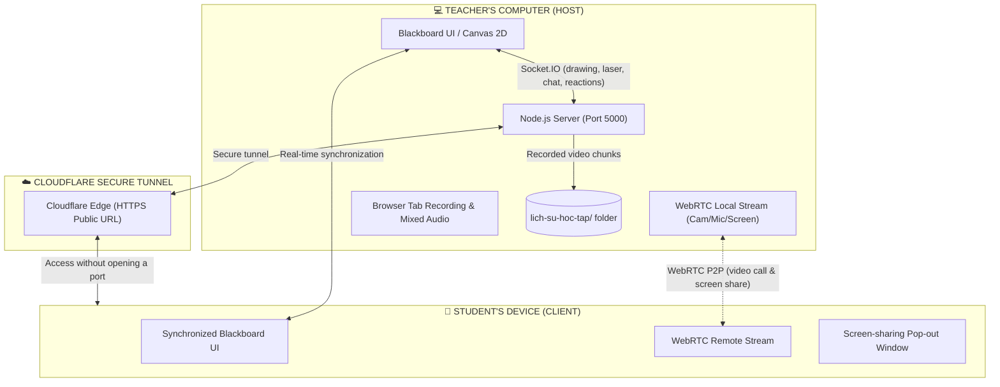

**Language / Ngôn ngữ:** [🇺🇸 English](README.md) | [🇻🇳 Tiếng Việt](README.vi.md)

# 📚 LearnBoard - Interactive Blackboard & 1-on-1 Video Lessons

<div align="center">


[](https://react.dev/)
[](https://nodejs.org/)
[](https://webrtc.org/)
[](https://socket.io/)
[](https://www.cloudflare.com/)
[](https://opensource.org/licenses/ISC)

**A focused 1-on-1 online teaching solution with a real-time interactive blackboard, image-based exercises, WebRTC P2P video calls, and full lesson recording.**

*Free to use • No domain purchase required • No server rental required • Start with one click.*

---

</div>

## 📖 Table of Contents

- [✨ Features](#-features)
- [🚀 Quick Start (One Click)](#-quick-start-one-click)
- [🔗 Connecting Teacher and Student](#-connecting-teacher-and-student)
- [🏗️ System Architecture](#️-system-architecture)
- [🗂️ Project Structure](#️-project-structure)
- [🛠️ Tech Stack](#️-tech-stack)
- [⚙️ Developer Commands](#️-developer-commands)
- [❓ FAQ and Troubleshooting](#-faq-and-troubleshooting)
- [📄 License](#-license)

---

## ✨ Features

### 1. 🎨 Real-Time Interactive Blackboard

- **Chalk-like drawing:** Multiple chalk colors and brush sizes from fine (2px) to large (16px).
- **A versatile toolset:**
  - ✏️ **Chalk pen:** Write text and math equations, and draw graphs.
  - 🧹 **Eraser:** Erase selected areas or clear the board.
  - 🖍️ **Highlighter:** Emphasize formulas and key terms.
  - 🔥 **Laser pointer:** Show a red neon trail that fades after 1.5 seconds.
  - 📐 **Shape tools:** Lines, arrows, rectangles, circles, and ellipses.
- **Customizable board backgrounds:** Switch between classic green, matte black, dark green, and a squared handwriting background.
- **Independent pan and zoom:** Teachers and students can zoom and move their own board view without affecting the other participant.

### 2. 🖼️ Paste Exercise Images (`Ctrl + V`)

- Take a screenshot of an exercise and press **`Ctrl + V`** (or use the image upload button) to place it on the board.
- Move, resize, rotate, and **pin** the image to the board so both participants can write over it.

### 3. 📹 1-on-1 Video Calls and Two-Way Screen Sharing (WebRTC P2P)

- WebRTC P2P video and audio, with TURN relay as a fallback. Actual latency depends on network quality and the selected connection route.
- **Two-way screen sharing:** Both teacher and student can share their exercise screens.
- **Separate pop-out window (`screen-viewer.html`):** Open a shared screen in its own browser window while continuing to work on the board.
- **Adaptive behavior:** A fallback video canvas is available when testing two tabs on the same computer. Screen sharing prioritizes responsiveness with `contentHint = 'motion'`.

### 4. 👀 Spectator Mode

- The room assigns the first teacher and student as active participants. Later visitors using the same link join as spectators.
- When a student link is opened, the app checks the room first and immediately shows the spectator screen if the teacher and student are already present.
- Spectators enter a name and choose a role: **Father**, **Mother**, or **Other**. Their classroom name appears as `Name (Role)`.
- Spectators can view the board in read-only mode. Drawing tools are hidden; spectators can pan or scroll but cannot draw or edit board content.
- The spectator list updates as people join or leave. Spectators receive the teacher's and student's video/audio streams and can chat or send praise reactions.
- Teachers can kick a student to change them to spectator mode, or kick a spectator out of the room. A removed user sees a message identifying the teacher.
- Spectators do not need to grant microphone or camera permissions, cannot share their screen, and cannot modify the board.
- This remains a WebRTC P2P setup: the teacher and student each establish an additional connection to every spectator. Upload bandwidth and connection count grow linearly with the number of spectators; TURN may increase relayed traffic. This mode is intended for small groups, not as a replacement for an SFU in large classes.

### 5. 🎙️ Full Lesson Recording (Browser Tab and Mixed Audio)

- **Record Browser Tab** captures the blackboard interface, drawing, exercise images, and video call.
- **Mixed audio (Web Audio API):** Combines the teacher's microphone and the student's audio in the recording.
- **Automatic local saving:** Video is streamed in real-time chunks to `lich-su-hoc-tap/*.webm` on the teacher's computer to reduce the risk of losing a recording if the browser closes unexpectedly.

### 6. ⭐ Multi-Sensory Praise and Encouragement

- Three praise reactions: 👏 **Great Job**, ⭐ **10 Points**, and ❤️ **Keep Going**.
- **Emoji-themed confetti:** Star, 100-points, trophy, or heart effects.
- **Floating praise badge:** Appears near the center of the screen with a bounce-in animation for 3.5 seconds.
- **Synthesized sound (Web Audio API):** Victory and congratulatory sounds generated in the browser without external MP3 files.

### 7. 💬 Instant Chat and Notes

- A chat panel supports quick messages, formulas, and links.
- Floating toast notifications and an unread-message count help users notice new messages.

---

## 🚀 Quick Start (One Click)

### Windows

Double-click:

👉 **`CHAY_LOP_HOC.bat`**

The script will:

1. Free port 5000 if an old process is using it.
2. Start the local Node.js server.
3. Create a free HTTPS tunnel with Cloudflare Tunnel.
4. Open the teacher page at `http://localhost:5000`.

---

## 🔗 Connecting Teacher and Student

1. **Start the app:** Run `CHAY_LOP_HOC.bat` or `npm run app`.
2. **Get the student link:**
   - Find it in the terminal, or click **Send link** in the camera bar at the top right.
   - It looks like:
     ```text
     https://random-subdomain.trycloudflare.com?role=student&room=lop-hoc-1
     ```
3. **Join the class:**
   - Send the link to the student through a messaging app.
   - The student can open it in a browser (**Chrome, Edge, Cốc Cốc, Safari on iPad, or a mobile browser**) without installing additional software.
   - The same link can be opened by additional viewers. Once a teacher and student are in the room, later visitors join as spectators.

### Optional: Configure Cloudflare TURN

To use TURN relay when a direct P2P connection cannot be established:

1. Create a TURN key in Cloudflare Realtime and an API token with **Calls: Write** permission for the relevant account.
2. Copy `.env.example` to `.env`, then set `CLOUDFLARE_TURN_KEY_ID` and `CLOUDFLARE_API_TOKEN`.
3. Restart LearnBoard. The backend creates short-lived credentials through `/api/ice-servers`; the browser receives temporary ICE credentials, not the API token or TURN key secret.

Do not commit `.env` or expose these secrets through `VITE_*` environment variables. Credentials are valid for 24 hours by default; set `CLOUDFLARE_TURN_CREDENTIAL_TTL` longer than the longest lesson (Cloudflare's current limit is 48 hours). If TURN is not configured or Cloudflare cannot issue credentials, LearnBoard logs a warning and continues trying STUN/P2P.

Once WebRTC connects, the browser console logs diagnostics every 10 seconds (`[WebRTC] Connection diagnostics`), including candidate type, RTT, bitrate, jitter, and packet loss. Screen sharing is limited to 15 fps and up to 1.2 Mbps to reduce uplink congestion, trading image quality for lower latency.

---

## 🏗️ System Architecture



---

## 🗂️ Project Structure

```text
LearnBoard/
├── CHAY_LOP_HOC.bat          # One-click launcher for Windows
├── server.js                 # Express and Socket.IO backend
├── tunnel.js                 # Automatic Cloudflare Tunnel launcher
├── package.json              # Backend dependencies and scripts
├── LOGS_AND_UPDATES.md       # Technical analysis and update log
├── README.md                 # English documentation
├── README.vi.md              # Vietnamese documentation
├── lich-su-hoc-tap/          # Automatically saved lesson recordings (.webm)
│
└── client/                   # Frontend source (React + Vite)
    ├── package.json          # Frontend dependencies
    ├── vite.config.js        # Vite build configuration
    ├── public/
    │   └── screen-viewer.html# Separate screen-sharing pop-out window
    └── src/
        ├── main.jsx          # React DOM entry point
        ├── App.jsx           # Lobby, classroom, and navigation
        ├── index.css         # Glassmorphism design system and animations
        ├── components/
        │   ├── Blackboard.jsx   # Board, tools, laser, recording, pan/zoom
        │   └── VideoOverlay.jsx # Video dock, chat, praise, screen sharing
        └── hooks/
            └── useWebRTC.js     # WebRTC P2P and fallback tracks
```

---

## 🛠️ Tech Stack

| Area | Technology | Purpose |
| :--- | :--- | :--- |
| **Frontend** | React 19, Vite | Responsive, fast user interface |
| **Board graphics** | HTML5 Canvas 2D Context | Chalk, laser, ruler, and anti-aliasing |
| **Real-time communication** | Socket.IO Client / Server | Drawing, laser pointer, and message synchronization |
| **Video and audio** | WebRTC (P2P), Web Audio API | 1-on-1 video calls, screen sharing, synthesized audio |
| **Lesson recording** | Screen Capture API, MediaRecorder | Browser-tab recording and mixed microphone/call audio |
| **Networking and tunnels** | Node.js, Express, Untun | Server and free Cloudflare Tunnel links |
| **Effects and icons** | Canvas-confetti, Lucide React | Confetti and interface icons |

---

## ⚙️ Developer Commands

To modify the source code or add features:

```bash
# 1. Install all dependencies (backend and frontend)
npm install
npm --prefix client install

# 2. Start development mode (hot reload for server and client)
npm run dev

# 3. Build the frontend for production
npm run build

# 4. Run the full app (server + Cloudflare Tunnel)
npm run app
```

---

## ❓ FAQ and Troubleshooting

#### Q: Do I need to buy hosting or pay for Cloudflare Tunnel?
> **No.** LearnBoard uses Cloudflare's free Quick Tunnels (`untun`), which do not require an account or credit card and do not incur charges.

#### Q: How can I test both teacher and student roles on one computer?
> Open `http://localhost:5000` in one tab as the teacher, then open an incognito window or another browser and use the student link. An **automatic virtual camera** fallback allows screen sharing and board interaction to work when Windows locks the webcam for the second tab.

#### Q: Where are lesson recordings saved?
> After a lesson ends, the `.webm` recording with audio from both sides is saved in the `lich-su-hoc-tap/` folder at the project root.

#### Q: Can students use an iPad or tablet to learn and draw?
> **Yes.** LearnBoard supports touch input and styluses such as Apple Pencil on iPad and tablets.

---

## 📄 License

This project is released under the open-source [ISC License](LICENSE). You are free to use, modify, and deploy it for teaching and learning.

<div align="center">
  <sub>Built with ❤️ for online education.</sub>
</div>
